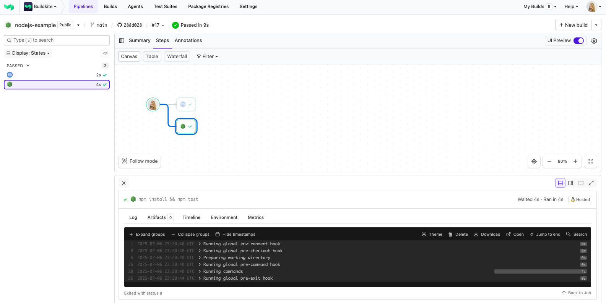

# Buildkite Node.js Example

This repository is an example [Buildkite](https://buildkite.com/) pipeline that runs tests for a [Node.js](https://nodejs.org/) project.

👉 **See this example in action:** [buildkite/nodejs-example](https://buildkite.com/buildkite/nodejs-example/builds/latest?branch=main)

See the full [Getting Started Guide](https://buildkite.com/docs/guides/getting-started) for step-by-step instructions on how to get this running, or try it yourself:

<!-- docs:start -->

## How it works

This example:
- Runs `npm ci` and `npm test` using the official Node.js image on a Buildkite hosted agent
- Pins the image version and digest, with Renovate updating to new LTS releases and merging updates after checks pass and the required approval is present

> 💡 For self-hosted agents using the Docker plugin, check out the [Node.js Docker Example](https://github.com/buildkite/nodejs-docker-example).

<!-- docs:end -->

## License

See [LICENSE.md](LICENSE.md) (MIT)
